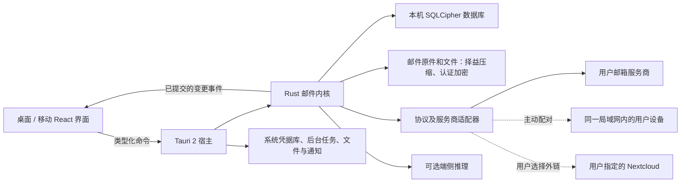

# 本地邮箱架构设计

> 本文保留早期方案与选型记录。现行源码路径和实现范围见[代码地图](../CODEMAP.md)。

**第一阶段设计稿 · 2026-11-20**

四端运行同一个 Rust 邮件内核。首次启动即可在本地导入、阅读和搜索邮件。添加真实邮箱后，由设备直接连接所选服务商。应用自身不设用户目录、邮件中转站、推送网关或账号恢复服务。

下图和目录描述自有 React/Tauri 宿主的候选设计。若从 Meron 或 Allodia 的开源客户端派生，保留相应宿主、Rust 内核和存储入口。三条路线共用本稿中的数据归属、失败状态、迁移和隐私验收条件。路线差异及实验证据见[完整方案与选型评审](06-完整方案与选型评审.md)。

## 1. 运行结构

| 仓库位置 | 职责和约束 |
| --- | --- |
| `apps/client` | React 页面与路由、Tauri 宿主、打包和各端入口。每个平台使用同一份核心代码。Swift 接 Apple 系统能力，Kotlin 接 Android，Windows 适配系统凭据、通知与安装集成。原生后台入口可在无界面的情况下唤起同一内核。 |
| `packages/ui` | 共享收件箱、会话列表、写信、附件、状态与无障碍组件。桌面多栏、移动导航栈共享同一交互语义。组件使用视图数据，不保存凭据或发送任务。 |
| `packages/contracts` | 暴露命令、事件、视图数据和稳定的错误码。Rust 可序列化类型为事实来源，构建时生成 TypeScript 声明，并在契约测试中检查兼容性。 |
| `crates/mail-core` | 负责账户隔离、邮件对象、同步游标、写入事务、发送状态、搜索、草稿、备份和冲突处理。可用内存服务商和临时目录独立测试。 |
| `crates/mail-adapters` | 实现 IMAP/SMTP、按需接入的服务商 API、离线导入、可选文件分享与推理适配。协议差异在这一层转为显式能力。组装由宿主完成，内核只依赖接口。 |

界面通过 Tauri IPC 调用宿主的白名单命令。宿主在本机进程内调用 Rust 内核，后台任务也使用同一入口。界面收到事件后用游标重新读模型，宿主重启、窗口漏收事件或系统取消后台任务时仍能恢复正确页面。通知、索引和统计都在相应数据提交后更新。

## 2. 存储、身份与可同步范围

SQLCipher 存邮件元数据、正文搜索索引、操作记录和设置。原始 MIME、已下载的附件和必要的预览缓存按本地集合或邮箱账户分区，以随机对象名保存在应用私有目录，使用经过审查的分块认证加密实现。下载与解密均有大小上限。附件先写加密临时文件，完成校验并原子改名后，在事务中登记为可用。崩溃以后可清理未登记对象，已登记却缺失的对象则显示待重取。仅本地导入的原件提示从备份恢复。

| 数据 | 最小身份与约束 |
| --- | --- |
| 本地档案 | 首次创建工作区与本地集合 ID，未绑定邮箱也可持久导入 EML。导入件保持所属集合，后来添加真实账户时无需伪造远端 UID 或更改来源。 |
| 账户与发件身份 | `Account` 指向邮箱及凭据引用。每个 `Identity` 绑定所属账户、可用发件地址和签名。不同账户可使用同一显示名，只有经服务商允许的别名才能选择。 |
| 邮件、会话与文件夹 | `Message` 使用本地稳定 ID。`Membership` 记录同一邮件在一个或多个文件夹中的位置。IMAP 远端键为账户、文件夹、UIDVALIDITY、UID 的组合。优先用服务商稳定 ID 建立跨标签关联。RFC Message-ID、主题或内容相似度均不可单独作为合并或删除依据。会话关系是可重建的建议分组。 |
| 正文与附件 | `BlobRef` 记录所属本地集合或邮箱账户、物理对象 ID、完整性摘要、MIME 类型、大小及下载状态。跨账户不共享文件引用或解密密钥。离线搜索和附件页能分别区分仅有邮件头、已下载正文和已缓存附件。 |
| 同步与操作 | 每文件夹保存 `SyncCursor` 以及服务商能力。每项改动写 `PendingOp`，带操作 ID、预期远端版本、动作和结果。列表的本地变更与待执行记录在同一事务中写入。 |
| 草稿与发件箱 | 草稿有本地版本。入队冻结发件身份、信封收件人、邮件正文版本及附件引用。单独保存 `Message-ID`。同一草稿版本的同一次提交只生成一项 `OutboxJob`，同机多个窗口与后台任务用事务争用同一发送权。 |
| 本地工具与配对 | 模板、签名、个人规则、联系人、待办、无回复提醒、AI 结果均按档案或账户保存。可选择在配对设备间同步的对象具有独立 ID、版本及删除记录。邮箱同步只传服务商支持的邮件、文件夹、标记和草稿。备份清单标明各项本地数据。 |

数据库密钥由系统安全存储保护。正文与附件对象使用分开的密钥用途。Apple 使用受数据保护策略约束的 Keychain，Android Keystore 保管不可导出的包装密钥，Windows 使用当前用户范围的 DPAPI。数据库和附件密钥、OAuth 令牌或授权码都不进入界面、日志、崩溃报告和普通设置。锁屏后系统不给密钥时，后台任务等待解锁并记录上次成功同步时间。移除账户前列出本地独有的草稿、导入邮件和待发项。确认后清理该账户的凭据、索引、对象和任务。

### 原件与文件的透明压缩

存储层接收原始字节，保存稳定的逻辑对象 ID、原始长度和 SHA-256。新对象分块决定保留原样（`raw`）或写为独立 Zstandard 帧（`zstd`），随后沿用同一认证加密层。读信、预览、导出和发件读取统一的原始字节流；原始 EML 中的 MIME 边界、Base64 换行和签名原文原样还原。文件没有转码或降画质。数据库、FTS、WAL 和模型文件继续使用各自的原生格式。

- **写入与读取。** 新格式的起测策略为每块最多 256 KiB，小于 1 KiB 直接原样；其余块以 Zstandard 3 级试压，只有节省至少 64 B 且达到原长 1% 才保留压缩结果。已识别的 JPEG、视频、ZIP/Office 容器可跳过试压；混合 EML、PDF 按实际内容取舍。附件如果已被编码进 EML，仍保留 EML 原样导出的能力。大件按块读取和取消，仅取已认证的块范围；不为看缩略图先解压整封邮箱。
- **完整性。** 封装记录版本、所属分区、对象 ID、原始长度、块数、顺序、编码与长度，头部和块索引受认证保护。每块先验密，再按上限解码；索引校验总长度和完整性，整件导出核对原始哈希。拒绝未知格式、缺块、乱序、截断或实际长度不符的对象。临时文件校验通过后才对用户发布。原样块也由同一加密层保护。
- **兼容与迁移。** 读取历史未压缩对象及上游原有编码。新写入走新策略。用户整理旧档案时，逐个写入新加密副本，验证长度与哈希后用事务切换引用；备份快照和其他引用释放后才回收旧对象。空间不足、进程终止或迁移被取消时保留可读版本。备份按清单携带编码或按同等能力重编码，用备份密钥重新保护；恢复遇到过新格式时保留当前档案。
- **节省量。** 在相同的唯一对象集合上，以原始载荷字节减去实际编码载荷字节计算压缩收益。去重与清理缓存各自计量。整封 EML 及已经解出的附件可能同时存在，文件中心优先用原信引用，按需生成缓存副本。完整档案另按文件系统实际分配空间统计，列出数据库/索引、对象、预览与临时数据；无法获得分配量的平台应注明显示的是文件长度。服务商容量保持独立口径。

该策略是三条底座共同的产品要求。Meron v0.5.5 的本地归档已把完整原件压成 Zstandard 9 级，并读回校验；该路径沿用原格式，增量覆盖普通缓存和单独的文件。Allodia 的已核独立引擎按摘要保存原始文件，适配时应在其对象接口内扩展。新增节省量要与各路线的原有实现分别比较。[Meron 原件归档](https://github.com/nonbili/meron/blob/v0.5.5/meron-core/src/store/archive.rs#L322-L381) · [Allodia 对象存储](https://github.com/allodia-eu/email-calendar-sync-engine/blob/a3cfc21e4d84920980b80f15d73cd04e956a4c1e/crates/store-sqlite/src/blob.rs#L74-L110) · [Zstandard 格式](https://www.rfc-editor.org/rfc/rfc8878.html)

## 3. 核心接口

| 界面或系统命令 | 责任及结果 |
| --- | --- |
| `listMessages(accountScope, filter, pageCursor)` | 返回稳定分页、下载范围与最后成功同步时间。离线查询直接使用本地库。 |
| `getMessage(accountId, messageId)` | 校验归属，返回安全正文和仅对当前邮件有效的附件句柄。每次下载、打开、分享均由内核复验该句柄。 |
| `saveDraft(id, expectedRevision, changes)` | 采用版本条件写入。冲突时保留两个版本供比较，避免两扇窗口静默覆盖。 |
| `queueSend(draftId, revision, identityId, dueAt, requestId)` | 核验归属和收件人，冻结内容，持久化后返回任务 ID。`cancelSend(jobId)` 只在仍可取消时生效。 |
| `startSync(accountId, trigger)` | 对同一账户合并重复触发，支持前台、系统调度、恢复联网和手动刷新。服务商能力决定实际动作。 |

界面只需订阅 `mailboxChanged`、`draftConflict`、`outboxChanged`、`syncStateChanged` 等事件。事件含作用域、对象 ID 和提交版本，不含令牌和正文。稳定错误码区分重新授权、系统锁定、配额不足、服务器暂时不可用、能力不支持、结果待核实，界面据此提供不同操作。

## 4. 收件、跨设备操作与草稿恢复

1. 通过系统浏览器向服务商授权，公共原生客户端使用授权码和 PKCE。需要授权码密码的邮箱走其官方方式。连接前校验证书与主机名，拒绝明文降级。授权范围以所选服务为单位。
2. 获取文件夹和服务商能力，先取信封与摘要、展示可读列表，再按下载策略获取正文和附件。IMAP 可用时启用 IDLE、CONDSTORE 或 QRESYNC。基础账户通过 UID 范围获取新邮件，并定期核对删除和标记。Graph 的增量同步游标按文件夹保存。每批数据和对应游标在同一事务提交，中途取消可从上批恢复。[IMAP4rev2](https://www.rfc-editor.org/rfc/rfc9051.html) · [快速重同步](https://www.rfc-editor.org/rfc/rfc7162.html) · [Graph 增量同步](https://learn.microsoft.com/en-us/graph/delta-query-messages)
3. 同一信箱在其他客户端已移动、删除或改标的邮件，回放本机操作前重新核对目标与前置条件。UIDVALIDITY 改变时废止旧映射并重新扫描，停止提交指向旧 UID 的操作。无可靠目标时向用户保留待处理项。服务商不支持安全的逐封清除时保留待删除标记，避免批量清除其他客户端标记的邮件。
4. 多端草稿优先利用服务商草稿箱。能校验前置版本的适配器采用条件写入。两个离线设备各自改写时能识别冲突就保留两个副本。协议无法检测并发覆盖时，保留本机最后编辑的草稿版本，恢复时可另存一份。POP3 如接入，定位为下载收件，默认保留服务器副本，文件夹和已读状态为本机属性。[POP3](https://www.rfc-editor.org/rfc/rfc1939.html)
5. 同步中断、进程挂起或系统通知权限关闭时，保留可读缓存和明确的更新时间。切回前台立即补同步。通知由已入库事件产生，同机按账户和事件 ID 去重。默认锁屏只显示有新邮件，正文预览由用户开启。

### 可选的同一局域网同步

没有产品账号时，两台设备仍有两条迁移路径。一次换机可离线传递第 7 节的口令加密包。长期同时使用两台设备，可在两端主动开启局域网配对，逐类选择设置、联系人、模板与签名、规则、待办和提醒。不开启配对也可独立使用全部本机流程。

- **建立关系。** 两端前台配对。发起端展示含设备公钥指纹与短时一次性随机值的二维码，另一端扫码并核对配对码。一次性口令只对本次握手有效。后续会话只信任已保存的对端密钥，双向认证、传输加密，用户随时可撤销设备。支持手动输入局域网端点，避免将组播发现设为必需条件。拒绝系统本地网络权限时可改用文件迁移。
- **增量与冲突。** 每项变更带设备 ID、该设备递增序号、对象 ID 及已见版本。每端持久保存对端已确认的进度，重连时重传未确认批次并去重。有因果顺序的后续修改覆盖其前序。并发改同一对象时保留两个版本和来源，用户的合并选择作为新版本传播。离线删除用墓碑传播。只有所有有效配对设备确认相应变更后才能回收墓碑。被移除设备再次加入时必须重新配对并以最新快照初始化，防止旧记录复活。
- **执行边界。** 邮件原件、收件进度、已读标志和服务商草稿走各自邮箱服务。凭据、附件缓存、发件队列和设备调度权不加入局域网同步。配对时确认两端账户映射，无法匹配的规则保持停用。任务可同步标题、到期时间与完成状态。本机定时发送可同步只读的计划摘要和设备名，只有原设备执行。需要换机接管时先暂停旧任务再在新机显式重建。无法确认旧设备已停用时不得自动接管。用户在两台设备上独立建立同一计划仍可能重复，界面提供设备名和计划详情用于核对。

## 5. 发送状态及多设备边界

`草稿 → 已排队 / 撤销等待 → 正在提交 → 服务商已接受`。临时故障、永久拒绝和提交结果不明分别存档。给用户的“已发送”指服务商接受提交，收件方回执与退信有独立状态。

| 场景 | 状态与恢复 |
| --- | --- |
| 用户连点、双窗口、前后台同时启动 | 请求 ID 和草稿版本抑制重复入队。发送执行者在事务中取得任务，传输前持久记录尝试阶段。恢复时检查阶段，已进入不可判定区间的任务不因租约过期而盲目重发。 |
| 离线、设备关机、逾期 | 任务由创建它的设备执行。设备可运行、已解锁且联网才提交。逾期任务按用户选定策略提示或补发。服务商支持并经适配器验证定时投递时，交由服务商后显示调度归属。成功登记后本机停止执行该任务。[SMTP 定时投递](https://www.rfc-editor.org/rfc/rfc4865.html) |
| SMTP 已交付完整 DATA 后断线，未读到最终答复 | 标记“发送结果待核实”，不自动重复发送。可用服务商记录和已发送副本辅助核对。若用户决定重发，界面说明可能重复。部分收件人被拒时，分别记录接受与拒绝的收件人。[SMTP §4.5.3.2.6](https://www.rfc-editor.org/rfc/rfc5321.html#section-4.5.3.2.6) |
| 服务商已接受，但已发送副本尚未归档 | 邮件保留已提交状态。服务商自动生成副本时等待同步。需要客户端归档时单独重试归档。撤销窗口内可取消本机入队，已提交后只有服务商明确支持才能发起撤回。 |
| 用户把账号加到第二台设备或恢复备份 | 新设备能从服务商读已发送邮件，克隆的发件任务和计划默认暂停，不自动接管。用户确认旧设备已停用后才显式重建所选任务。多台独立设备各自点击“发送”无法通过本地锁去重。 |

发件前将 Bcc 收件人存入信封并与出站头部分离，预览对地址、账户和别名进行最终确认。来信规则在事务中记下规则版本、触发事件和目标账号。同一批次只处理一次同一动作，移动引起的后续事件检测循环。两个设备同时启用同一条会修改服务器的规则时，仅指定执行设备写回，其他设备显示执行结果；纯视图聚合可各自运行。服务商限流按其重试提示退避。重新授权后恢复同一账户待发队列，切换默认邮箱不会替换已冻结的发件身份。

## 6. 正文、搜索和可选外部连接

- **正文阅读器**接收清洗后的 HTML，在禁脚本、无宿主 IPC、无原生权限的隔离上下文显示。限制样式、嵌套、表单、外部资源、导航及危险 URL 协议。引用图像只能使用当前邮件授权的 CID 句柄。外部图片默认阻断，单封加载前提示其网络行为。链接展示实际目标，由用户操作后交系统浏览器。附件通过系统文件能力显式打开或分享，临时明文有生命周期并在恢复时清理。[Tauri 能力与权限](https://v2.tauri.app/security/capabilities/)
- **搜索**默认只查已缓存邮件，显示账号、时间、发件人、正文/附件名等筛选和覆盖范围。SQLCipher 中维护 FTS5 索引。中文三字及以上用 trigram 子串匹配，一至两字在限定范围内用短词匹配，并测试两字人名、主题、日文和中英混写。附件全文提取如启用，须限制文件格式和大小，索引缺失不影响原件。[SQLite FTS5](https://www.sqlite.org/fts5.html#the_trigram_tokenizer)
- **端侧 AI**由独立适配器运行。翻译或单封摘要只传当前选中的内容；自然语言查信先在选定账号范围内做本地检索。多封问答与周报从检索结果取片段，并保留邮件 ID 供用户返回原信。可见范围外的账号和未下载的附件不能成为回答依据。按设备内存限制上下文并允许取消。模型可由本地文件安装。如果用户选择下载，显示来源、大小、许可证和校验结果。模型输出是待审稿，不具备访问链接、发送邮件或执行正文指令的权限。模型缺失、空间不足或推理取消时，保留原文和人工写信入口。
- **大附件外链**由用户选定 Nextcloud 服务与目标文件后，明确展示外发接收端。上传完成并确认分享链接可用后，才将链接插入草稿。失败保留附件引用、已上传对象 ID 和重试或清理入口。过期、下载权限和撤销以服务端能力为准，撤销无法收回对方已下载的副本。普通 WebDAV 若不支持分享 API，只供文件存取。[Nextcloud 分享 API](https://docs.nextcloud.com/server/latest/developer_manual/client_apis/OCS/ocs-share-api.html)
- **隐私与观察**默认出站目的地限于用户已添加的邮箱及其认证端点。局域网配对、外链附件、模型下载和邮件远程图片由相应的用户操作开启。诊断默认仅记录时间、类别、协议阶段和错误码。凭据、主题、地址、正文、附件名和完整请求 URL 均不进入诊断日志。不内置远程分析或后台邮件内容采集。

## 7. 备份、迁移与验收

备份时取数据库一致性快照并锁定关联文件引用，将原始邮件、已缓存附件及本地工具数据组成带版本号、哈希和对象清单的加密包。由独立的备份口令派生密钥，界面提供备份覆盖范围并标明未下载对象。授权码、令牌、设备安全存储密钥及配对私钥排除在包外。恢复先在临时档案校验版本、认证标签、清单和引用，再为目标设备生成新密钥并原子切换，原档案可保留至恢复通过。错误口令、损坏包、格式过新和空间不足均不能覆盖现有档案。恢复的邮箱需要重新授权，新设备生成新的设备身份并重新配对。

实施验收使用合成邮件、隔离测试服务及专门的测试账号。跨四端至少覆盖同一组故障场景。

| 验证动作 | 可观察结果 |
| --- | --- |
| 飞行模式冷启动并导入 GB18030 邮件及附件 | 不出现应用登录，原件可导出，已缓存正文与短词可检索，外部图片无网络请求。 |
| 两个客户端互相改标、移动，再令服务器 UIDVALIDITY 改变 | 重新映射期间停止旧操作。无邮件误删，冲突有记录。 |
| 两台已配对设备断开局域网，各自修改同一联系人、修改与删除同一规则，再重连两次 | 两端呈现相同冲突版本，用户合并后两端一致，重复批次不产生副本。移除旧设备再重新配对，已确认删除的记录不复活，定时发件的执行设备仍唯一。 |
| 在 SMTP 提交确认前断线，再杀进程、重启或恢复备份 | 未确认项清楚可见，服务器邮箱中没有因应用自动重发产生的重复邮件。 |
| 打开含远程图片、脚本、嵌套页面、跨账号附件引用的合成邮件 | 正文不能调用宿主，无法读取其他账户附件。未经点击不联网。 |
| 锁屏后收到邮件、关闭系统通知、再打开应用 | 记录最后成功同步时间。系统允许后补拉，通知与正文显示遵循权限。 |
| 导出加密备份至本机，分别使用错误口令、损坏文件和正确口令恢复 | 前两次原档案可打开。成功恢复后源文件摘要一致，待发项暂停且账号需重新授权。 |
