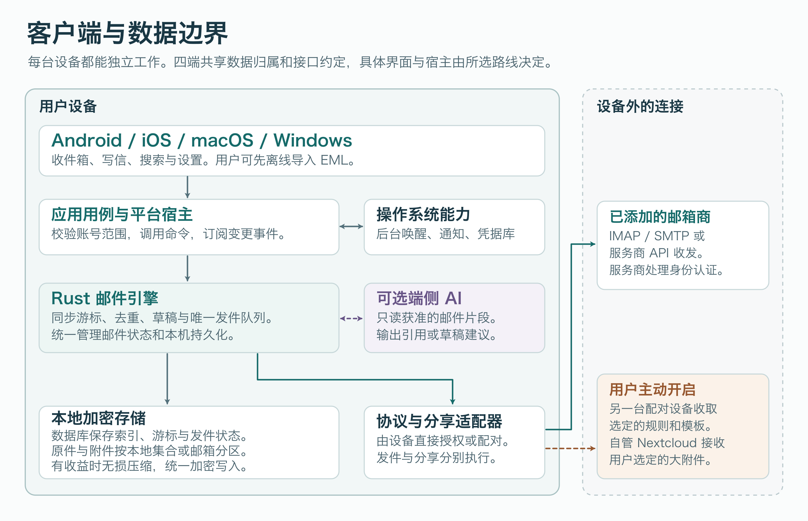
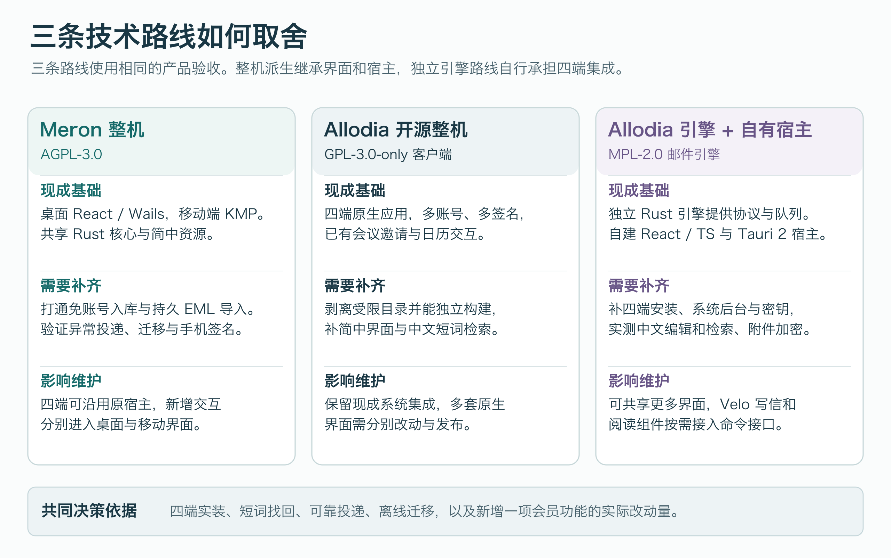
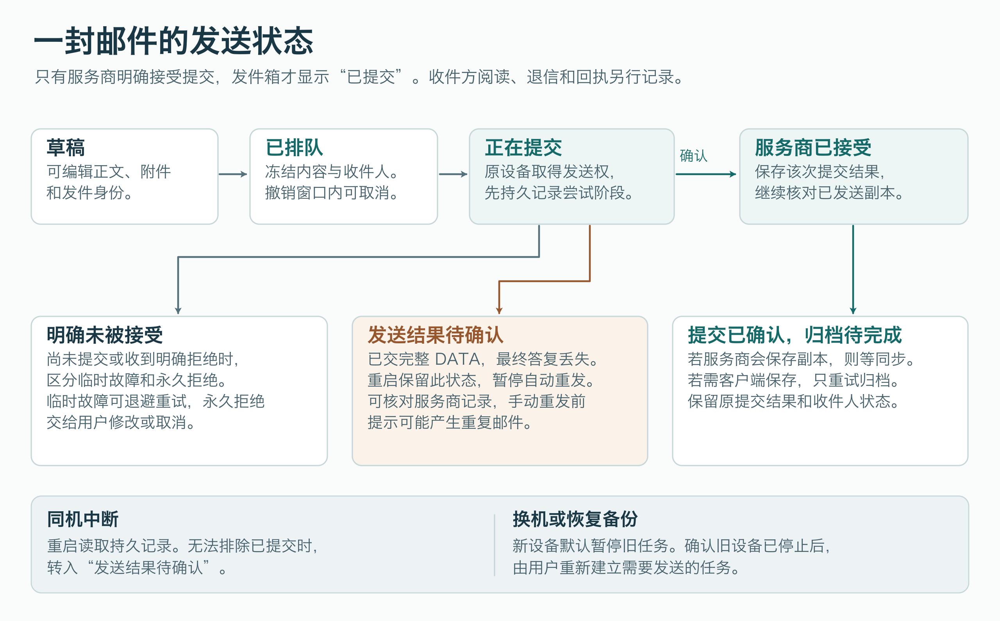
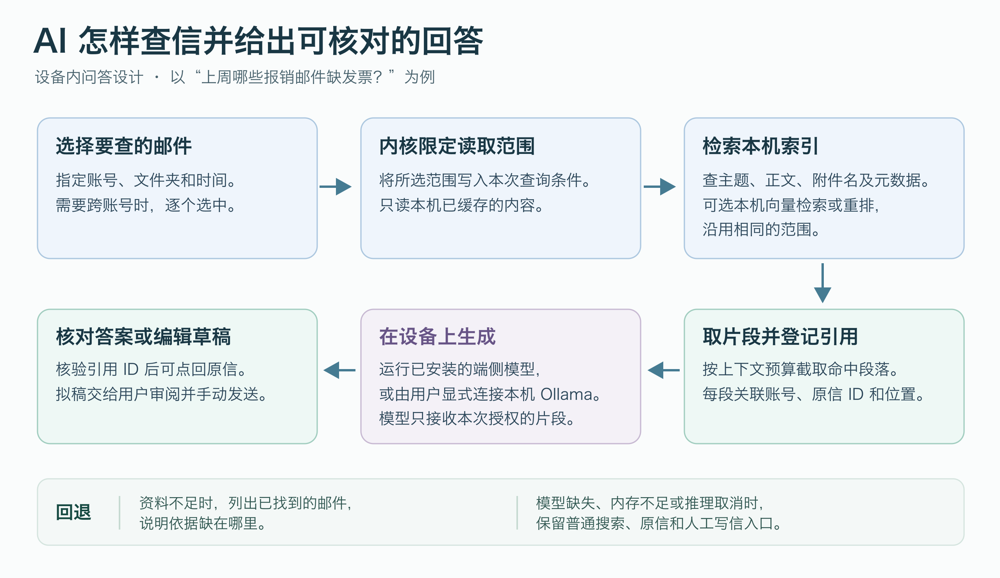

# 本地邮箱技术架构与选型

> 本文保留早期方案与选型记录。现行源码路径和实现范围见[代码地图](../CODEMAP.md)。

**第一阶段设计评审 · 2026 年 11 月 20 日**

Android、iOS、macOS、Windows 共用邮件处理规则。用户可以断网打开应用、导入一封邮件、写草稿；要收发时，再向自己的邮箱服务商授权。系统不需要本产品的账号服务器或邮件中转站。AI 是可以单独安装、关闭或替换的本地能力。

**建议先确定三个边界。** 第一，邮件内核管理邮件、游标、草稿和发件队列，每个档案只有一个逻辑写入入口。第二，界面、后台任务和通知都通过这个入口读取已经提交的数据，手机被挂起也能从磁盘恢复。第三，AI 只能读取用户选定范围的材料，接受草稿和最终发送由用户操作。

**底座仍在评估。** Meron 是“四端尽早可用”的参照；Allodia 独立引擎加 React/Tauri 是“长期沿用熟悉的技术栈”的参照。Allodia 的开源整机也参与比较。下文的接口、加密、四端安装和 AI 属于拟建设计。已有选型实验见第八节，本地压缩实测见第九节。

## 一、三条路线分别能省下什么

| 路线 | 可继承的工作 | 需要用样例证实的成本 |
| --- | --- | --- |
| **A · 派生 Meron** | 四端宿主、简中资源、邮件收发、中文短词查找和桌面归档。桌面用 React/TypeScript + Wails，手机用 Kotlin Multiplatform，共享 Rust 内核。 | 空账号首启默认进入设置向导，直接打开 EML 使用临时阅读会话。要接成可搜索的本地档案，且补验手机发送确认不明、富文本签名和跨端恢复。派生按 AGPL-3.0 处理。 |
| **B · 派生 Allodia 开源客户端** | 原生界面、多签名、会议邀请、日历和离线队列，适合看重系统日历体验的用户。 | 增加简中和中文词中查找，维护多个原生宿主。免费主体为 GPL-3.0-only；仓库含仅供审阅的付费目录，排除后还须修复工作区清单，再验证开源构建。 |
| **C · Allodia 引擎 + 自有宿主** | MPL-2.0 独立引擎提供协议、同步游标与持久发件队列。React/TS 可共享附件中心、模板和规则界面。 | 新建四端宿主、后台入口、系统凭据、编辑器和安装链。要适配数据库和外置原件加密。Velo 的 Apache-2.0 写信组件可选用，移植时对接本项目接口。 |

**我的判断。** 若 A 只需局部补齐首次导入和发件状态，继承四端客户端对首版最划算。若 A 必须同时重写存储、手机主流程和发件队列，而 C 的手机样例能通过可靠性验证，C 更值得长期投入。若会议工作流是主要价值且目标设备能接受较高系统下限，B 的原生体验才有足够权重。[Meron 固定版](https://github.com/nonbili/meron/tree/v0.5.5) · [Allodia 应用许可边界](https://github.com/allodia-eu/mail-calendar/blob/ff174c92c4d293c8b8280ede9b685386a401a264/allodia_license/LICENSE.md) · [独立引擎](https://github.com/allodia-eu/email-calendar-sync-engine/tree/a3cfc21e4d84920980b80f15d73cd04e956a4c1e) · [Velo 发行版](https://github.com/avihaymenahem/velo/releases/tag/velo-v0.4.21)

## 二、熟悉的技术栈怎样落到工程里

以下是路线 C 的拟议工程结构。若选 A 或 B，同一组业务约定保留，宿主和构建工具跟随上游。四端共享的是邮件行为与数据契约；桌面多栏、手机导航、系统授权回调和后台启动有各自的实现。

| 模块 | 技术选择 | 负责什么，怎样独立验证 |
| --- | --- | --- |
| 应用与组件 | `apps/client`，React、TypeScript、Vite；`packages/ui` | 列表、阅读、写信、搜索。组件接收带账号范围的视图数据。用模拟视图独立验证输入法、键盘、触控及错误状态。 |
| 宿主与系统入口 | Tauri 2、Swift、Kotlin、Windows API | 把窗口、分享、文件选择、凭据、通知和后台唤醒接进内核。邮件 HTML 在隔离的阅读环境打开，脚本和宿主命令关闭。 |
| 调用契约 | `packages/contracts`；Rust 类型生成 TS 声明 | 仅暴露明确命令、字段、版本和错误码。窗口漏收事件后按版本重新查询。持续集成校验生成声明与 Rust 类型一致。 |
| 邮件业务与协议 | Cargo workspace；`crates/mail-core` 为适配入口 | 内嵌选定引擎，沿用其事务、游标和队列。新增功能通过引擎接口写入；需要原子性时在同一引擎事务扩展。先验证 IMAP/SMTP，再按账户能力扩展其他协议。 |
| 存储与搜索 | SQLite、SQLCipher 社区版、FTS5；外置文件择益无损压缩后加密 | UI 与模型均不直连数据库。逐端验证 FTS、WAL、临时预览、原件文件和升级后的密钥可用性。Allodia 默认把原始字节写到独立文件，这一层有实际改造量。 |
| 仓库与构建 | pnpm workspace + Cargo workspace | UI、契约、内核可分别构建测试，根入口聚合检查。锁文件、工具链版本、依赖许可和安装制品校验值随发布保留。 |

**主要接口。** `listMessages(scope, filter, cursor)` 只返回当前页和同步范围；`getMessage(scope, id)` 返回清洗后的正文和本信的附件句柄；`saveDraft(id, expectedRevision, edits)` 检出冲突；`queueSend(draftId, revision, identityId, dueAt, requestId)` 在持久入队后返回任务 ID，内核从冻结的草稿核验发件身份。这里列的是接口语义，正式参数以生成的契约为准。后台与前台调用同一个 `startSync`；界面收到变更事件后重读已提交的数据。[Tauri 权限模型](https://v2.tauri.app/security/capabilities/) · [Allodia 原件文件实现](https://github.com/allodia-eu/email-calendar-sync-engine/blob/a3cfc21e4d84920980b80f15d73cd04e956a4c1e/crates/store-sqlite/src/blob.rs#L81-L108)

**其他框架。** Electron 桌面搭配 Capacitor 手机可以继续使用 React，但需要维护两套宿主和协议桥接。Flutter 作为跨端界面备选，需要重新积累 Dart 组件和富文本编辑能力。若实测只有某一端的编辑器或后台接入不合格，优先替换那个模块，再考虑更换整个 UI 技术栈。[自有宿主技术选型明细](04-技术选型与四端安装.md)

## 三、从离线导入到收信、搜索与规则

**无邮箱也能有档案。** 首次启动产生工作区 ID 和本地文件夹 ID。导入 EML 时，先保留原始 MIME 字节及摘要，再解码主题、正文、地址和附件名。原始字节用于导出和重建，索引用于查找。导入件归本地集合所有，无需伪造邮箱账号或服务器 UID。以后添加真实邮箱，已有导入件继续保留原来源。

| 数据对象 | 身份与归属 | 防止的具体问题 |
| --- | --- | --- |
| 邮件与文件夹成员关系 | 本地邮件 ID 稳定；远端 IMAP 定位由账号、文件夹、UIDVALIDITY 和 UID 组成。邮件可对应多个成员关系。 | Gmail 多标签重复展示、跨账号同主题误合并、文件夹重建后沿用旧 UID 误操作。 |
| 原件、正文与附件 | 原件和附件各带所属分区、对象 ID、大小、哈希及缓存状态。本地档案和各邮箱分别校验访问范围。 | 查见附件名却误报文件已下载；同名附件打开错误会话；数据库加密而原件仍明文。 |
| 同步游标与待办操作 | 每邮箱文件夹保存游标。每批变更和对应游标同事务提交。本地改标与待回放操作也同事务写入。 | 程序中断后跳过一批信，或把同一次移动执行两遍。 |
| 草稿与发件任务 | 草稿有版本；入队时冻结发件身份、收件人、正文版本和附件引用。 | 两扇窗口覆盖草稿；调度时误用后来切换的账号；后台重复投递。 |

**收信路径。** 系统浏览器向服务商授权，令牌留在系统凭据库。适配器先取信封和文件夹变化，再按用户策略取正文与附件。加密文件落盘并校验后登记可用，提交数据后才通知列表刷新。失效授权只暂停对应账号。国内常见邮箱先验 IMAP/SMTP；Gmail 标签、Microsoft 365 的 Graph 路径和租户策略分别验证。POP3 按下载能力展示。[IMAP 规范](https://www.rfc-editor.org/rfc/rfc9051.html) · [Microsoft Graph 增量同步](https://learn.microsoft.com/en-us/graph/delta-query-messages)

**检索与会员功能。** 三字以上的中文子串优先走 trigram，单字、双字先按授权范围与日期过滤，再匹配子串。附件名用索引分页查询，结果携带精确原信 ID。发件人聚合仅改变视图；真正移动或打标的分类规则先预览，再由内核记录和执行。跨设备远端写入类规则默认交给指定设备，其他设备保留预览；没有服务商幂等保证时，不把“每台设备各自去重”计为跨设备只执行一次。离线或执行设备休眠时明确显示延迟。[SQLite FTS5](https://www.sqlite.org/fts5.html#the_trigram_tokenizer) · [会员功能对照](02-竞品与会员功能对照.md)

## 四、发送可靠性与定时任务

**“服务商已接受”是一个明确的状态。** 两个窗口同时点发送，只产生一个持久任务。只有能够确认服务商尚未接受的临时失败才自动退避重试。SMTP 可能在服务器已收信后断开，应将任务持久记为“发送结果待确认”。重启后可查已发送副本等线索；缺少足够证据时保留待确认，由用户决定是否再次发送。[SMTP 规范](https://www.rfc-editor.org/rfc/rfc5321.html) · [Allodia 的上游用例](https://github.com/allodia-eu/email-calendar-sync-engine/blob/a3cfc21e4d84920980b80f15d73cd04e956a4c1e/crates/engine-sync/src/tests/drain/sends.rs#L113-L137)

**三个容易混淆的结果。** 提交成功、写入“已发送”文件夹失败，只补归档。多个收件人中仅部分通过收件地址检查时，分别记录各地址的结果。只有服务商最终确认了邮件提交才将相应地址标记为已接受，并从重试范围排除；最终确认不明的地址仍留待核实。已投递邮件的阅读回执单独记录，能否获得回执取决于对端。

**定时发送属于执行设备。** 只要任务留在本机，关机、锁屏或后台限时都可能让它逾期；恢复时展示原定时间和实际状态。只有服务商接口明确接受预约，界面才显示“已预约到服务器”。备份恢复后暂停待发项，在另一台设备查看计划不会自动取得发送权。

## 五、AI 怎样接入，又怎样回到原信

**以“上周发出的报价，谁还没回复”为例。** 用户先选择账号和时间段。内核列出实际发出的报价，再在已同步收件范围内按回复头、往来地址和时间寻找回复。引用保存账号或本地集合、原信 ID、片段位置及版本。模型只整理已检索的证据。结果可以写“截至周五 18:00，已同步邮件中未找到甲方回复”，同时列出原报价、搜索范围与最后同步时间。同主题匹配可信度低时，保留“需核对”。

**本机推理有两种接法。** 四端可试验嵌入 llama.cpp，中文起测候选为 Qwen3-1.7B；桌面另可显式连接本机回环地址上的 Ollama。后者需选择已在本机的模型并关闭云功能，单凭访问地址无法证明推理离线。首版先做全文检索与证据片段；向量索引只在基准测试证明能提高召回时引入。若未来增加外部 API，需要单独配置目的地和数据范围，当前设计不会因本地推理失败而将邮件转发给外部模型。[llama.cpp](https://github.com/ggml-org/llama.cpp) · [候选模型卡](https://huggingface.co/Qwen/Qwen3-1.7B) · [Ollama 本地模式](https://docs.ollama.com/faq)

**验收看原信和边界。** 用已知答案的合成邮箱统计找回了几封、引用能否精确打开、回答有无超出证据。跨账号结果、已删除邮件和未下载附件不可进入上下文。模型缺失、证据不足或手机内存不足时，展示已有检索结果并允许手工起草。每种机型记录模型文件大小、首字等待时长、整次耗时、峰值内存和取消后能否释放。生成回复先交给用户检查，模型没有发信、打开外链或执行正文指令的权限。

## 六、哪些数据跟着邮箱走，哪些跟着设备走

| 数据路径 | 允许传什么 | 中断、换机或冲突时的行为 |
| --- | --- | --- |
| **设备 ↔ 邮箱服务商** | 授权后的邮件、文件夹、已读状态和服务商支持的草稿。协议与权限按账号核对。 | 以服务商游标续传。两个设备离线编辑同一草稿时，能识别冲突就保留两份。服务商重建文件夹时暂停基于旧 UID 的操作。 |
| **本人设备 ↔ 局域网配对设备** | 用户勾选的规则、模板、签名、联系人、待办等。双方前台扫码或核对指纹，建立设备信任。 | 每设备保存变更序号和确认进度。并发编辑保留冲突，删除以记录传播。移除设备后重新配对。令牌、配对私钥和发件执行权排除在外。 |
| **原设备 → 加密文件 → 新设备** | 一致性快照、原始邮件、已缓存附件、草稿及本地设置。清单写明版本、范围、校验值和缺失对象。 | 新设备先在临时档案验证口令、内容和版本，再原子切换。错误口令、损坏包或空间不足均保留旧档案。邮箱重新授权，待发项暂停。 |

**密钥和附件。** iOS/macOS 用 Keychain，Android 用 Keystore 中的密钥包装应用密钥，Windows 用当前用户范围的 DPAPI。业务数据库、索引和外部原件分别检查加密。用户主动预览或导出明文附件后，告知目标位置，临时文件有限期并可在下次启动清理。锁屏得不到密钥时等待解锁，不以放宽凭据保护换取后台收信。[Apple Keychain](https://developer.apple.com/documentation/security/keychain-services) · [Android Keystore](https://developer.android.com/privacy-and-security/keystore) · [Windows DPAPI](https://learn.microsoft.com/en-us/windows/win32/api/dpapi/nf-dpapi-cryptprotectdata)

**正文和可选出站。** 正文默认拦截脚本、远程图片和第三方头像。内嵌图片只接受当前邮件的附件句柄。超大文件由用户自行选择已有 Nextcloud、文件和有效期，服务端确认链接可用后才写入草稿。日志只记协议阶段、时间和错误码。备份和本机加密能够保护已经保存的数据；服务器扩容、原厂专线、远端隔离浏览和专属撤回按服务商能力列出差异。[Nextcloud 分享接口](https://docs.nextcloud.com/server/stable/developer_manual/client_apis/OCS/ocs-share-api.html)

**删除也要跨层处理。** 删账号先展示独有的导入件、草稿和待发项，确认后清理凭据、对象、搜索及 AI 衍生索引。打开旧问答的引用时重新校验归属和版本，原件已删除就提示失效。卸载与清缓存不能被实现成服务端删除。

## 七、四个平台怎样安装和验收

| 平台 | 给用户的安装物 | 该端必须过的验证 |
| --- | --- | --- |
| **Android** | 提供签名 APK 直装，商店渠道另构建 AAB。升级沿用包名与兼容签名。 | 干净安装、离线导入、系统分享、拒绝通知权限、Doze 后补同步、覆盖升级后仍能解密。Meron 源码 minSdk 24，Allodia 开源整机 minSdk 31。 |
| **iOS** | 自用通过 Xcode 开发签名装机；公开测试用 TestFlight，正式分发走 App Store 等适用渠道。 | 真机输入法、富文本、文件分享、锁屏挂起、恢复后同步和授权回调。已核 Meron 要求 iOS 17、Allodia 要求 iOS 18；较早提出的 iOS 16 目标需单独验证。 |
| **macOS** | 已签名和公证的应用及 DMG，用户拖入“应用程序”。Apple Silicon 先测，Intel 另验。 | 无网络首次打开、公证票、菜单/多窗、安装两版后的数据兼容。上游清单、语言运行时的系统下限、派生版实际支持范围分别记录。 |
| **Windows** | 自有宿主路线提供签名安装器，可选 NSIS EXE 或 MSI；整机派生可沿用已验证的原生打包方式。 | 在 Windows 11 x64 干净环境和已有安装上分别验证。采用 WebView2 的宿主另测离线缺运行时；覆盖升级保留档案、密钥与草稿。 |

**首测范围。** 原设计提出 Android 10、iOS 16、macOS 13 和 Windows 11 作为候选环境。系统下限属于取舍项。Allodia 的 Apple 工程声明 macOS 15；若要支持较旧电脑，需要把向下适配的人日和可替代路线列在同一张实测表。用户免费获取和使用软件，开发者签名、账号及发行渠道各有条件。[四端安装方式与费用](04-技术选型与四端安装.md) · [Apple 后台任务](https://developer.apple.com/documentation/backgroundtasks/choosing-background-strategies-for-your-app) · [Android 后台安排](https://developer.android.com/develop/background-work/background-tasks/persistent/getting-started/define-work) · [Tauri Windows 安装器](https://v2.tauri.app/distribute/windows-installer/)

**每端做一次两版本演练。** A 版导入合成档案、建立草稿、下载附件并保留一条确认不明的发送记录。覆盖安装 B 版后，核验对象摘要、搜索、凭据、任务状态及回退快照。结果记设备、系统、安装渠道、版本、签名和实际步骤。服务商互通另用专用账号验证，应用安装成功与邮箱可用分别记录。

## 八、用什么证据决定底座

已有四项本机结果改变了设计。它们来自固定源码、合成邮件和本机测试服务器。各项目的四端整机安装、公开发行和真实服务商互通仍待验证。

| 已观察到的结果 | 对产品和选型的直接影响 |
| --- | --- |
| 同样四封中文信，预期两封含“报销”。按源码策略复现，Meron 命中 2，Allodia 命中 1，Velo 默认全文命中 0。 | 所有候选都测单字、双字和附件名。十万封预热索引样本的搜索首屏 P95 目标为一秒，记录建库时间、内存和体积，目标尚未实测。 |
| Velo 原查询在 201 个附件中默认只返回最近 200 个。扩大范围可找回目标，界面点击后打开会话。 | 验收直接搜索最早一个附件，再检查是否准确打开所属账号的那一封邮件。 |
| GreenMail 已接受邮件后，本机故意截住最终确认，收件箱中已有 1 封。按相同 Message-ID 重新提交后变为 2 封。 | 每条路线都必须在进程重启、第二个窗口和换机恢复后仍保持“结果待确认”。用收件箱实际封数验收。 |
| Meron 导出函数的 8 个上游用例及 1 个中文用例通过。Allodia 原工作区列出 21 个包，排除受限目录后，同一元数据命令退出 101。 | A 继续验完整换机；B 先拿可自由分发的源树重建四端。两项结果的覆盖范围各自保留。[实验记录与运行方法](research/实验记录.md) |

**建议的决策顺序。** 先用同一份标签明确的合成邮件，在 Mac 和 iPhone 上比较三条路线的最小工作流。分别走通断网导入、按中文附件找原信、联网收发、中断时恢复、AI 返回带出处的答案。AI 未具备的候选用同一只读接口做独立样例，成熟度单列。

再让合格路线扩展到 Android 与 Windows，比较一次“附件找原信”和一次“新增分类规则”四端实际改动的包、上游文件和人日，核对公开源码许可、签名与升级。若多条路线均满足本地性和可靠性，以达到同样验收所需的实际改动量及后续维护量作决定。当前没有客户端安装包或 AI 成品。

**核查基线。** Meron 桌面 v0.5.5、Velo v0.4.21、Allodia 应用 `ff174c92`；该应用锁定引擎 `5e6ec402`，另行研究的独立引擎为 `a3cfc21e`。产品交付仍按 15 项需求和 28 个竞品对标分组逐项核验。[产品验收](01-产品需求与验收.md) · [来源与选型依据](06-完整方案与选型评审.md)

## 九、本地邮件与文件的无损压缩

**第一阶段新增 R15。** 收到邮件、导入 EML、保存附件或本地文件时，默认由设备判断是否值得压缩。用户照常打开、搜索、转发和导出，无须手动解压。导出的邮件和文件要逐字节还原，照片、签名邮件与视频都保留原质量。这项能力同时列入三条底座路线的验收。

**同一条存储路径。** 原始字节 → 分块并计算原件摘要 → 选用 Zstandard 或原样块 → 认证加密 → 临时对象校验 → 切换引用。读取时先验密，再按块解码。每块最多 256 KiB，起测采用 Zstandard 3 级，块小于 1 KiB 或节省不够时保留原样。已知压缩格式可跳过试压，混合 EML 和 PDF 则看内容。旧档案保留原读取路径，整理过程中被中断仍可读取；快照及全部引用释放后再回收旧副本。[Zstandard 格式](https://www.rfc-editor.org/rfc/rfc8878.html)

| 同一份合成文件 | 载荷字节，原始 → 自动压缩 | 本机临时文件实际分配，原始 → 自动压缩 |
| --- | --- | --- |
| 中文纯文字 EML | 2,854 → 550 B | 4 → 4 KiB |
| 含 JPEG 照片的完整 EML | 231,888 → 174,816 B | 228 → 172 KiB |
| 16,000 行 CSV 附件 | 510,983 → 66,871 B | 500 → 68 KiB |

以上实际分配量按该 Mac 上单个样本的临时载荷文件测得。独立 JPEG、ZIP 和含 JPEG 的 PDF 走原样保存。全部合成样本还原后的 SHA-256 一致。正式客户端会额外占用加密封装、数据库、搜索索引和预览空间。[本机样本和复跑方法](research/本地压缩实验.md)

**存储页怎样展示。** 用户能看见当前档案实占、邮件原件与附件的原始量，以及编码实际省掉的字节。索引、预览和临时文件单列。重复附件复用同一份数据的收益另算。产品发布前用相同样本，在 Android、iOS、macOS、Windows 各建“原样”和“自动压缩”两份档案，比较实占、首次打开耗时、导入速度、内存与耗电，再决定各端默认参数。

**怎样复用。** Meron 已对本地归档邮件使用 Zstandard 9 级。选它时保留原格式，并核验常规缓存和单独附件；选择 Allodia 引擎时，在现有对象读写入口接入。独立 Rust 压缩块组件已通过 8 个回归用例，同批 8 种合成文件均能还原。与客户端加密存储的集成、四端整库占用及性能仍待实测。[Meron 归档实现](https://github.com/nonbili/meron/blob/v0.5.5/meron-core/src/store/archive.rs#L322-L381) · [Allodia 原件存储](https://github.com/allodia-eu/email-calendar-sync-engine/blob/a3cfc21e4d84920980b80f15d73cd04e956a4c1e/crates/store-sqlite/src/blob.rs#L74-L110)
